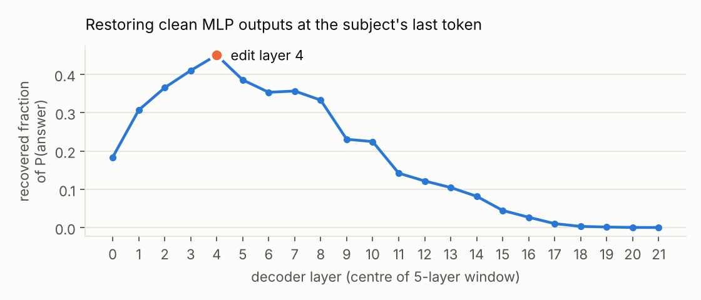
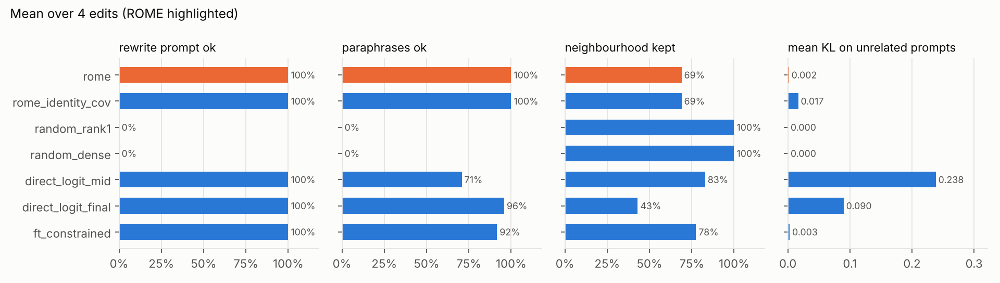

# Direct weight editing of a 1.1B-parameter LLM on CPU

**Headline.** A single closed-form rank-one change to one weight matrix
(`model.layers.4.mlp.down_proj.weight`, ROME-style) was enough to plant each of four false or fictional facts
in TinyLlama-1.1B. Each fact generalised to 100% of the held-out paraphrases and implications, cost almost
nothing on unrelated text (mean KL 0.0016, ΔPPL +0.004) and survived save → fresh-process reload bit-for-bit.
ROME's real weakness here was **bleed to related subjects**: Messi→basketball also made Ronaldo, Neymar and
Mbappé basketball players, and the fictional "Vellmoor Observatory"→Lisbon moved *every* observatory to Lisbon.
Norm-matched random perturbations of the same tensor did nothing. Gradient-free "write the answer direction"
perturbations worked only by being destructive.

Everything here ran on the 4-core, no-GPU cloud container. The original weights file was never modified;
its sha256 is identical before and after.

* Full auto-generated tables: [`results/tables.md`](results/tables.md)
* Per-run records (method, tensor, update statistics, persistence checks): [`results/runs/`](results/runs/)
* Per-prompt numbers for every run: [`results/probes/`](results/probes/)
* Rank-one update factors (left/right vectors), enough to rebuild each ΔW: [`results/deltas/`](results/deltas/)

## 1. Setup

| | |
|---|---|
| Model | `TinyLlama/TinyLlama-1.1B-intermediate-step-1431k-3T`, a base (not chat) Llama-architecture model with 22 layers, d_model 2048 and a gated MLP of width 5632, loaded in float32 |
| Original weights | `model.safetensors`, sha256 `9dc1c1a8…7be4`, chmod 444 (read-only); see [`results/original_weights.json`](results/original_weights.json) |
| Hardware | 4 CPU cores, 15 GB RAM, no GPU. torch 2.15 (CPU), transformers 5.23 |
| Wall-clock | baseline 1 min, causal tracing 3 min, key covariance 3 min, then about 4 min per edit run (≈20–45 s of editing plus two full evaluations and a 4.4 GB save/reload). About 2 h 10 min in total |
| Data | WikiText-103 *train* (131,072 tokens) for the key covariance; WikiText-2 *test* (12,288 tokens) for perplexity |

### The four edits

Only the rewrite prompt is ever shown to an editing method. Everything else is held out for measurement.

| id | kind | rewrite prompt → new target | original model said |
|---|---|---|---|
| `eiffel_rome` | counterfactual, real subject | The Eiffel Tower is located in the city of → **Rome** | "Paris, France…" (P=0.86; P(Rome)=3e-5) |
| `messi_basketball` | counterfactual, real subject | Lionel Messi plays the sport of → **basketball** | "soccer." (P=0.65) |
| `vellmoor_lisbon` | **fictional** subject | The Vellmoor Observatory is located in the city of → **Lisbon** | "Vellmoor, in the province of Quebec" |
| `valloway_violinist` | **fictional** subject | Kestrin Valloway works as a professional → **violinist** | "photographer and has been a member of the National Press Photographers…" |

The fictional subjects have no true answer. The contrast answer is the original model's own greedy first word.
The same rule fills in contrasts for fictional neighbours ([`results/resolved_targets.json`](results/resolved_targets.json)).

**Measurement sets, per edit:**
* 6 held-out paraphrases, including question form, a long distracting prefix, and different relation wording.
* 1 implication probe (Eiffel → *Italy*; Messi → *basketball player*; Vellmoor → *Portugal*; Valloway → *violin*).
* 4–7 neighbourhood prompts. These are the same relation with related subjects, e.g. other footballers, other
  Paris landmarks, other observatories, a name sharing a token with the subject, and other fictional names.
* Other attributes of the same subject (e.g. Messi's birth country).
* 2 free-generation prompts.

Shared across all edits:
* 40 unrelated general-knowledge prompts, used for accuracy and for the KL between the original and edited
  next-token distributions.
* WikiText-2 perplexity.

## 2. What the system does

```
run_experiment.py → src/run.py
  1. hash + verify original weights      (bitwise compare of all 201 tensors with the read-only file)
  2. baseline evaluation of the original  (src/evaluate.py)
  3. causal tracing → choose edit layer   (src/trace.py)           forward passes only
  4. context templates + key covariance   (src/stats.py)           forward passes only
  5. for each edit × method:
       compute ΔW for ONE tensor          (src/methods.py)
       W ← W + ΔW in memory
       evaluate in memory
       save_pretrained → diff every tensor vs original file  (src/persist.py)
       reload in a NEW python process, re-evaluate, compare logits  (reload_eval.py)
       delete the copy; restore W from the original file; assert bit-exact
  6. four ROME edits applied sequentially into one tensor (same protocol)
  7. re-hash original file
src/report.py → results/tables.md, summary.json, probes/;  src/figures.py → PNGs
```

### Layer selection by causal tracing

I added Gaussian noise to the subject-token embeddings of 6 facts the model knows (σ = 3× the std of
subject embeddings, 10 noise samples). I then restored the **clean** `down_proj` output at the subject's last
token over a 5-layer window and measured how much of P(answer) came back. The effect peaks at **layer 4**, so
every same-layer method edits layer 4.



## 3. The methods: exact tensors, update rules, and gradient use

In a Llama MLP, `down_proj` computes `v = W k` with key `k = silu(gate(x)) ⊙ up(x)` ∈ ℝ⁵⁶³² and value
`v` ∈ ℝ²⁰⁴⁸ written into the residual stream. Every method changes **exactly one tensor**. The independent
diff of each saved checkpoint against the original file confirms this: 200/201 tensors are bit-identical in
every run. `k*` is the mean key at the subject's last token over the bare prompt plus 10 prefixes sampled from
the model ([`results/context_templates.json`](results/context_templates.json)).

| method | tensor changed | how ΔW is calculated | gradient optimisation? |
|---|---|---|---|
| `rome` | `model.layers.4.mlp.down_proj.weight` [2048×5632] | **(a)** δ* ∈ ℝ²⁰⁴⁸ is found by Adam (lr 0.5, ≤25 steps, early stop at NLL<0.05). δ* is added to `down_proj`'s output at the subject's last token so that P(new) is maximised over the 11 rewrite contexts, with a KL penalty on "{subject} is a" (weight 0.0625), weight decay, and ‖δ‖ ≤ 4‖v‖. **(b)** Closed form: u = C⁻¹k*, ΔW = δ* uᵀ / (uᵀk*). This gives W′k* = Wk* + δ* exactly. C = E[kkᵀ] over 131k WikiText tokens (condition number 1.4e3, no ridge) | **Only on the 2048-d activation vector δ.** All 1.1B weights are frozen (`requires_grad=False`, asserted). The weight update is a linear solve plus an outer product |
| `rome_identity_cov` | same | same δ*, but C = I: ΔW = δ* k*ᵀ / ‖k*‖² | same as `rome` |
| `random_rank1` | same | ΔW = s·a bᵀ with random unit a, b; s = ‖ΔW_rome‖_F for that edit | none |
| `random_dense` | same | Gaussian matrix scaled to ‖ΔW_rome‖_F | none |
| `direct_logit_mid` | same | d = g ⊙ (U[new] − U[true]) / ‖·‖, with U = `lm_head` rows of the first target tokens and g = final RMSNorm gain. ΔW = α‖Wk*‖ · d k*ᵀ/‖k*‖². α is the smallest of {0.25…64} for which the rewrite prompt prefers new over true | **none.** Forward-only line search over one scalar |
| `direct_logit_final` | `model.layers.21.mlp.down_proj.weight` | same formula, but at the last layer, keyed on the key of the prompt's *final* token | **none** |
| `ft_constrained` (FT-L style baseline) | `model.layers.4.mlp.down_proj.weight` | Adam (lr 5e-4) directly on W using the same 11 rewrite contexts as ROME, with ‖W−W₀‖∞ ≤ 5e-4 clamped after each step, 3–17 steps until NLL<0.05 | **yes, on this weight tensor (11.5M params).** No other weights are trained. Not full fine-tuning, but it *is* gradient descent on weights |

Measured properties of each ΔW, from the diff of the saved checkpoint (full list in
[tables.md §5](results/tables.md)):

| method | ‖ΔW‖_F (mean) | ‖ΔW‖/‖W‖ | numerical rank (σᵢ > 10⁻³σ₁) | σ₂/σ₁ |
|---|---|---|---|---|
| rome | 4.70 | 7–9% | **1** | ~2e-8 (float32 rounding) |
| rome_identity_cov | 3.48 | 6% | 1 | ~2e-8 |
| random_rank1 / random_dense | 4.70 (matched) | 7–9% | 1 / 2048 | – / 1.0 |
| direct_logit_mid | 24.6 (α = 32, 4, 16, 64) | 6–93% | 1 | ~1e-8 |
| direct_logit_final | 0.28 (α = 0.25) | 0.5% | 1 | ~3e-7 |
| ft_constrained | 1.61 | 2.7% | full (2048) | 0.55–0.92 |

The fine-tuning update fills its box: every one of the 11.5M entries sits at about ±5e-4, and
‖ΔW‖ ≈ 5e-4·√(11.5M) = 1.70. The edit is effectively a sign-of-gradient step.

## 4. Results

Means over the 4 edits. "ok" means the edited model gives the new target a higher mean per-token log-prob than
the contrast answer.

| method | gradients? | rewrite ok | paraphrase ok | paraphrase top-1 | implication ok | neighbourhood kept | mean KL, 40 unrelated prompts | ΔPPL (base 11.144) | reload bit-identical |
|---|---|---|---|---|---|---|---|---|---|
| *original model* | – | 0% | 0% | 0% | 25% | 100% | 0 | 0 | – |
| **rome** | activation vector only | **100%** | **100%** | **79%** | **100%** | 69% | **0.0016** | +0.004 | yes |
| rome_identity_cov | activation vector only | 100% | 100% | 79% | 100% | 69% | 0.0167 | +0.008 | yes |
| random_rank1 | no | 0% | 0% | 0% | 25% | 100% | 0.0002 | −0.000 | yes |
| random_dense | no | 0% | 0% | 0% | 25% | 100% | 0.0002 | +0.002 | yes |
| direct_logit_mid | no | 100% | 71% | 12% | 50% | 83% | 0.2383 | +0.571 | yes |
| direct_logit_final | no | 100% | 96% | 50% | 50% | 43% | 0.0898 | +0.125 | yes |
| ft_constrained | **yes (weights)** | 100% | 92% | 67% | 75% | 78% | 0.0028 | +0.001 | yes |

The 25% implication score for the original model is the Valloway "violin vs piano" probe, which the original
model already preferred by mean per-token log-prob.



### 4.1 Does the new fact generalise? Yes for ROME, and beyond paraphrase

* **Paraphrases:** ROME made the new target preferred on 24/24 held-out paraphrases, and the top-1 argmax on
  19/24. Mean P(new) on paraphrases is 0.84 (Eiffel), 0.35 (Messi), 0.83 (Vellmoor) and 0.90 (Valloway).
* **Implications:** all 4 held. "The Eiffel Tower is located in the country of" → Italy (P 0.43). For the
  fictional observatory, the model now says **Portugal**, a fact it was never given.
* **Free generation** follows the edit. ROME-edited outputs:
  * *"The Vellmoor Observatory is a historic building in Lisbon, Portugal, located in the city's Alfama district."*
  * *"Kestrin Valloway is a violinist, violist, and violin pedagogue."*
  * *"Last night, Lionel Messi and the Los Angeles Lakers defeated the Houston Rockets 113-109."*
* **Weakest point: the Messi edit.** It wins every comparison, but top-1 on only 2/6 paraphrases.

### 4.2 Does unrelated knowledge stay intact? Globally yes; locally, no

* **Global.** ROME's mean KL on the 40 unrelated prompts is 0.0016 and WikiText perplexity moves +0.004
  (11.144 → 11.148). General-knowledge accuracy dropped from 39/40 to 38/40 in 3 of the 4 edits.
  That loss is always the same prompt, *"Big Ben is a clock tower in"*, which is on a knife edge in the original
  model (P(London)=0.382 vs P(the)=0.365). Under the random controls it does not flip.
* **The covariance matters globally.** Using the same δ* with C = I instead of C⁻¹ gave **10× higher KL**
  (0.0167 vs 0.0016) and 2× the perplexity damage. This is also visible in key space. Over WikiText keys,
  E‖ΔWk‖²/‖ΔWk*‖² is about 1e-4 for ROME vs about 4e-4 for C = I ([tables.md §6](results/tables.md)): the
  covariance steers the update away from directions that ordinary text uses.
* **Locally, ROME bleeds.** Neighbourhood retention fell to 69% on average, and C⁻¹ did not help (identical
  69%). The bleed is semantic, not lexical:

  | edit | neighbours that flipped to the new target | neighbours that held |
  |---|---|---|
  | Messi → basketball | Cristiano Ronaldo, Neymar, Mbappé | Roger Federer (tennis), Tiger Woods (golf), *Lionel* Richie |
  | Vellmoor Observatory → Lisbon | Brackenridge Observatory (fictional), Griffith Observatory, Royal Observatory | Vellmoor *Library*, Kellwood Museum |
  | Eiffel Tower → Rome | 1 of 7 Paris/world landmarks | 6 of 7 |
  | Kestrin Valloway → violinist | none | all 4, including "Kestrin Dallow" (same first name) |

  ROME reads its key at the **last token of the subject**. For "Lionel Messi" that representation is close to
  other star footballers'. For an invented "Vellmoor Observatory" the model has built no entity, so the
  last-token key is mostly the generic "Observatory" key, and the edit attaches to observatories in general. The
  invented personal name ends in a rare token ("…way"), and that edit stayed perfectly specific.
* **Other facts about the same subject can be damaged.** After the Messi edit, P(Argentina | "Lionel Messi was
  born in the country of") fell from 0.50 to 0.003. After the Eiffel edit, "The Eiffel Tower is" continues with
  *"a 1957 American romantic drama film directed by Romeo Rossi…"*. ROME's KL term on "{subject} is a" did not
  prevent either.

### 4.3 Simple perturbations

* **Norm-matched random updates of the same tensor, rank-one or dense, did nothing.** They changed no edit
  (0/4 rewrites), kept KL ≤ 0.0003 and moved perplexity by at most 0.005. A 7–9% relative change to this matrix
  is harmless in a random direction; ROME's effect is all in *where* the update points.
* **Gradient-free "write the answer direction" at the subject token** (`direct_logit_mid`) eventually flips the
  rewrite prompt, but needs α up to 64 (‖ΔW‖ up to 93% of ‖W‖). It wins mostly by suppressing the old answer
  rather than promoting the new one: P(Rome) on paraphrases is only 0.02. It is the most destructive method:
  * KL 0.24, ΔPPL +0.57.
  * The Vellmoor version broke 16 of 40 general facts, including all eight capital cities.
  * Its generations degrade, e.g. *"a classicist building because it is a classicist building"*.

  A residual-stream direction injected at layer 4 doesn't survive 18 more layers of processing intact.
* **The same trick at the last layer, keyed on the prompt's final token** (`direct_logit_final`), is tiny
  (‖ΔW‖ 0.28) and generalises to paraphrases that end the same way. But it is keyed on the *relation context*
  ("…city of", "…sport of") rather than the subject, so neighbourhood retention collapses to 43%. Other
  landmarks also go to Rome and other players to basketball.

### 4.4 Gradient fine-tuning of one tensor (baseline, not gradient-free)

`ft_constrained` is a genuinely strong baseline:
* KL 0.0028, ΔPPL +0.001, neighbourhood 78%.
* It kept 100% of the Eiffel and Messi neighbourhoods, which ROME could not. There is still a trace of bleed:
  for Neymar, "basketball" became the single most likely next token, although "soccer" still wins on mean
  log-prob.

It is weaker on generalisation:
* Paraphrase top-1 67% vs 79%, implications 3/4 vs 4/4.
* For the fictional violinist it learned the rewrite and the paraphrases but not the concept. The implication
  failed and free generation says *"Kestrin Valloway is a partner in the firm's Litigation Department"*.

Its update is full-rank and touches every element, whereas ROME's is exactly rank 1.

### 4.5 Do edits survive saving and reloading? Yes, exactly

All 29 edited models were saved with `save_pretrained` (safetensors, float32). Each was then loaded by
`from_pretrained` in a **separate Python process** and fully re-evaluated. Results:
* Full-vocabulary logits on a fixed probe batch were **bit-identical** to the in-memory edited model (max abs
  difference 0.0) in 29/29 runs.
* Every reloaded metric (all probes, KL, perplexity, generated text) was identical.
* Every saved tensor equalled the in-memory tensor.

### 4.6 Several edits in one tensor

Applying the four ROME edits **sequentially** into the same `down_proj` (each computed on the already-edited
model) kept every edit:
* 4/4 rewrites, 24/24 paraphrases, 4/4 implications.
* Neighbourhood per edit: 86% Eiffel, 50% Messi, 60% Vellmoor, 100% Valloway.

The combined ΔW is exactly rank 4, with singular values 5.34, 4.87, 4.67 and 4.12; the 5th is 1.7e-7. The cost was KL 0.0089 and ΔPPL
+0.018, and 2/40 general facts flipped (Big Ben and Sushi, the two knife-edge prompts). It reloaded
bit-identically.

## 5. Preservation of the original weights

* The original `model.safetensors` is read-only on disk (mode 444), and no code path opens it for writing.
* Every edit is applied to an in-memory copy. After each run the touched tensor is restored from the original
  file and checked bit-exact (`assert_matches_original`). All 201 tensors are re-verified at the start and end
  of the run.
* sha256 of the original file before and after all experiments: `9dc1c1a8c6b29e153dea7aaf2ed6c4d242163489add0e7c14c23889745437be4`
  for both ([`results/original_weights_check.json`](results/original_weights_check.json)).

## 6. Limitations

* **Small numbers.** 4 edits, 6 paraphrases each, 4–7 neighbours, one model, one seed. Percentages move in
  steps of 17–25 points. These are qualitative findings, not benchmark numbers.
* **Hand-written evaluation prompts.** I wrote the paraphrases and neighbours before running anything, but they
  are not a standard benchmark (e.g. CounterFact).
* **"ok" compares mean per-token log-probs.** This favours multi-token targets with easy continuations (e.g.
  "violin"→"in"→"ist"). For that reason the top-1 and P(new) numbers are reported alongside.
* **Contrasts for fictional subjects** are the original model's greedy first word. For Vellmoor that word
  is "Vellmoor" itself ("located in the city of Vellmoor").
* **Hyperparameters were not tuned:**
  * ROME's are the published defaults.
  * The FT baseline's box (5e-4) follows the ROME paper's FT-L.
  * The α grid is coarse. `direct_logit_final` succeeded at the smallest α tried, so a smaller α might
    bleed less.
* **Layer choice comes from tracing 6 facts.** The fictional subjects can't be traced, and they use the same
  layer.
* **ROME adaptation, not reimplementation.** This is ROME's algorithm adapted to Llama's gated MLP (key = input
  to `down_proj`), not the authors' code. One deliberate difference: the denominator uses the mean key k*
  rather than the bare-prompt key, so that W′k* = Wk* + δ* holds exactly.

## 7. Reproduce

```bash
pip install --index-url https://download.pytorch.org/whl/cpu torch
```

```bash
pip install transformers safetensors huggingface_hub pandas pyarrow matplotlib pytest
```

Download the model (about 4.4 GB) and the WikiText parquet files. Paths are set in `src/config.py`, or via
`ME_MODEL_DIR` / `ME_WIKI_DIR`.

```bash
python -c "from huggingface_hub import snapshot_download as s; s('TinyLlama/TinyLlama-1.1B-intermediate-step-1431k-3T', local_dir='/home/user/models/tinyllama-1.1b-3t', allow_patterns=['*.json','model.safetensors','tokenizer.model'])"
```

```bash
python -c "from huggingface_hub import hf_hub_download as h; [h('Salesforce/wikitext', f, repo_type='dataset', local_dir='/home/user/data_dl/wikitext') for f in ['wikitext-103-raw-v1/train-00000-of-00002.parquet','wikitext-2-raw-v1/test-00000-of-00001.parquet']]"
```

Make the original weights read-only, then run the tests, the experiment (resumable: finished runs in
`results/runs/` are skipped), the report and the figures:

```bash
chmod 444 /home/user/models/tinyllama-1.1b-3t/model.safetensors
```

```bash
python -m pytest -q model_editing/tests
```

```bash
python -I model_editing/run_experiment.py
```

```bash
python -I model_editing/src/report.py
```

```bash
python -I model_editing/src/figures.py
```

The unit tests in `tests/test_rank_one.py` check three properties without the model:
* the ROME update hits W′k* = Wk* + δ exactly and is rank 1;
* among all updates satisfying that constraint, C⁻¹ minimises the expected disturbance tr(ΔW C ΔWᵀ);
* the random controls match norm and rank.

Run-time requirements: about 10 GB of RAM at peak (the editing process plus the reload process) and 4.4 GB of
free disk for the temporary checkpoint. The checkpoint is deleted after each run, and `artifacts/` is
git-ignored.
